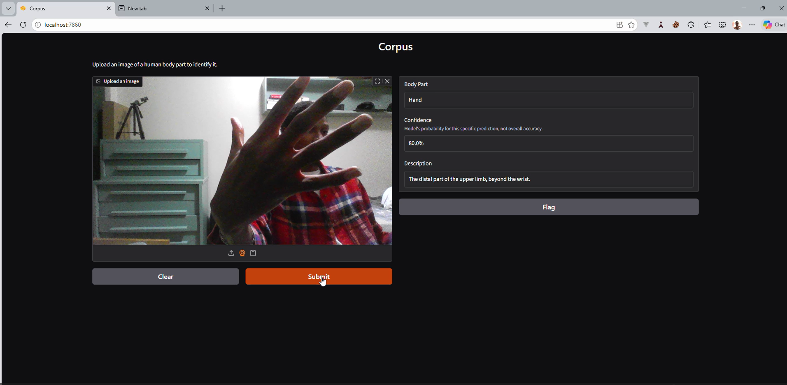

# Corpus

Identifies the body part shown in a photo: show your hand to the camera or upload an image, and get the predicted body part, a confidence score, and a short anatomical description.

Built by [Primaris Labs](https://github.com/Primaris-Labs) as a first open-source machine learning project.


## Contents

- [Overview](#overview)
- [Results](#results)
- [Tech Stack](#tech-stack)
- [API](#api)
- [Run Locally](#run-locally)
- [Next Steps](#next-steps)

## Overview

Corpus classifies photos of human body parts into **10 classes** (hand, knee, shoulders, neck and more). It fine-tunes a **MobileNetV2** network pre-trained on ImageNet (**transfer learning**) on the **[Body Parts Dataset](https://www.kaggle.com/datasets/linkanjarad/body-parts-dataset)** (2,092 images), trained on a GPU in **Google Colab**.



The trained model is served by a **FastAPI** REST API and a **Gradio** web interface, both packaged with **Docker**. Tests run with **pytest** on every push through **GitHub Actions**.

## Results

| Metric | Value |
|---|---|
| Validation accuracy | **76.59 %** |
| Classes | 10 |
| Images | 2,092 |
| Data split | 70 % train / 15 % validation / 15 % test |

**Known limitations.** The model still produces a notable number of false positives: it sometimes predicts a body part with high confidence when the image shows another one. Part of the cause is the dataset itself, which mixes regular photos with X-rays, anatomical drawings and watermarked images, and some photos don't cleanly isolate their label (for example, an "eye" photo that also shows the nose). This inconsistent labeling sometimes skews the reported accuracy. The per-prediction confidence score should therefore not be read as a measure of correctness yet. Reducing these errors is the current focus (see [Next Steps](#next-steps)).

## Tech Stack

| Layer | Technology |
|---|---|
| **Model** | PyTorch, torchvision, MobileNetV2 (transfer learning) |
| **Training** | Google Colab (GPU), Jupyter |
| **API** | FastAPI |
| **Interface** | Gradio |
| **Infrastructure** | Docker, Docker Compose, Dev Containers |
| **Testing & CI** | pytest, GitHub Actions |

## API

`POST /identify` takes a base64-encoded image and returns the most likely body part.

```json
// Request
{ "image": "<base64-encoded image>" }

// Response
{
  "part": "Hand",
  "confidence": 0.87,
  "description": "The distal part of the upper limb, containing the carpals, metacarpals, and phalanges."
}
```

`confidence` is the model's softmax probability for the predicted class, not an accuracy measure.

## Run Locally

Requirements: Docker and a Kaggle account (to download the dataset).

```bash
git clone https://github.com/Primaris-Labs/corpus.git && cd corpus
cp .env.example .env            # add your Kaggle credentials
python data/download.py         # download the dataset
python src/model/train.py       # or train on GPU with notebooks/explore.ipynb in Colab
docker-compose up               # API on :8000, interface on :7860
```

Run the tests with `pytest tests/ -v`.

## Next Steps

- [ ] Report accuracy on the held-out **test set**, plus per-class results and a confusion matrix
- [ ] Clean the dataset: remove X-rays, drawings and watermarked images that do not match real photos
- [ ] Reduce false positives: data augmentation, class balancing, and an "uncertain" answer below a confidence threshold
- [ ] Compare MobileNetV2 with a larger backbone such as ResNet-50
- [ ] Host a public demo

## License

MIT
